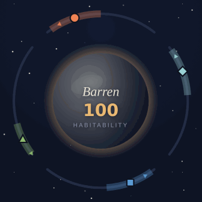
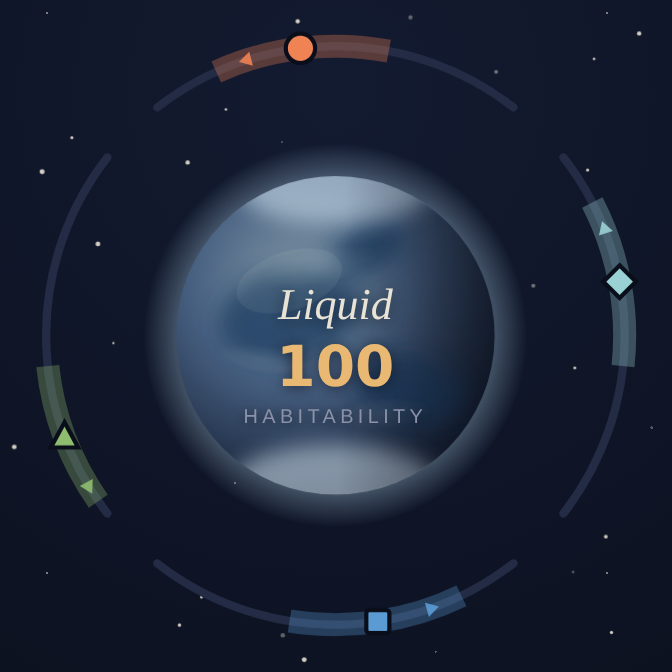
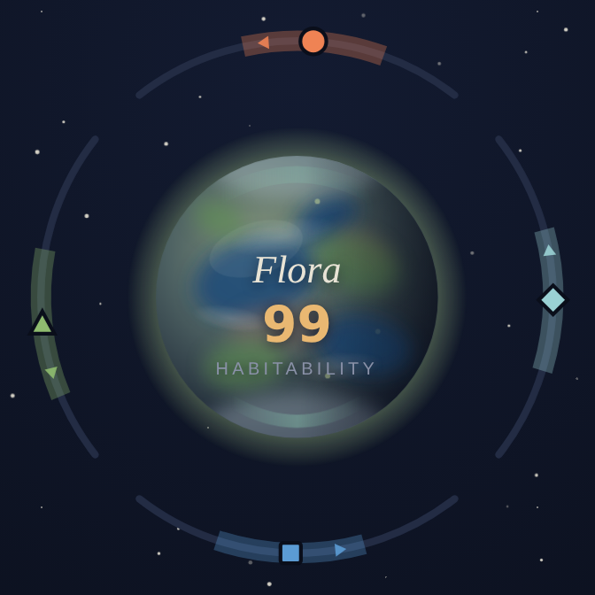
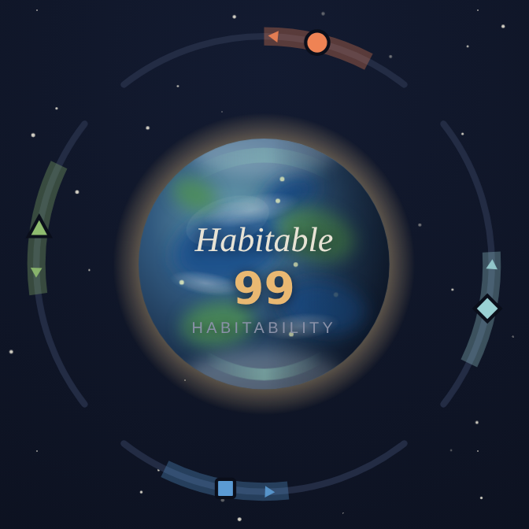

# TerraTouch

[](https://github.com/schmug/terratouch/actions/workflows/ci.yml)

A mobile-first, touch-first terraforming clicker/roguelike PWA. You raise a
dead world toward habitability one swipe at a time — and when it collapses,
an AI chronicler writes the obituary of your planet.

**▶ Play it: https://terratouch.pages.dev** (installable — add it to your
home screen). Milestone 1 is live: the full core loop with templated
narration; prestige, synthesis, and the live LLM chronicler are next.

- **[SPEC.md](SPEC.md)** — the full design spec (source of truth)
- **[CLAUDE.md](CLAUDE.md)** — orientation + hard rules for coding agents
- **[Issues](https://github.com/schmug/terratouch/issues)** — all outstanding
  work: milestones (M2–M6), balance findings, and enhancements

## Watching a world come alive

Seven eras, one sphere. The geography is fixed on purpose — the same seas
that darken in Liquid grow green shores in Flora — so it reads as one world
waking up, not seven different planets. Between screenshots the planet is
never still: clouds drift with the thickening atmosphere, an aurora shimmers
once the air holds, life motes wander the greenery, a day/night terminator
sweeps past, and the habitability glow slowly breathes.

<p align="center">
  
</p>

| Barren                                            | Liquid                                                              | Flora                                                  | Habitable                                                                      |
| ------------------------------------------------- | ------------------------------------------------------------------- | ------------------------------------------------------ | ------------------------------------------------------------------------------ |
|  |  |  |  |

Regenerate with `npm --prefix app run shots` — see
[docs/shots/README.md](docs/shots/README.md).

## Layout

| Dir                  | What                                                       | Deploys to                                     |
| -------------------- | ---------------------------------------------------------- | ---------------------------------------------- |
| [`app/`](app/)       | React + Vite + TS PWA (sim engine, UI, persistence)        | Cloudflare Pages                               |
| [`worker/`](worker/) | Loss-narration endpoint (`POST /api/narrate` → Workers AI) | Cloudflare Workers (M4 — currently a 501 stub) |

## Develop

```sh
npm --prefix app install
npm --prefix app run dev        # dev server
npm --prefix app test           # vitest (sim suite + 1000-run balance harness)
npm --prefix app run harness    # balance harness with the full report
npm --prefix app run build      # typecheck + build → app/dist
npm --prefix app run walk       # 35-check e2e acceptance walk (needs Chrome
                                #   + a server; WALK_BASE overrides the URL)

npm --prefix worker install
npm --prefix worker run dev     # wrangler dev
```

The app is a complete, playable game with zero backend; the Worker only
writes the loss story and always has a local templated fallback.

Deploy note: Cloudflare Pages must use build command
`npm --prefix app ci && npm --prefix app run build` (output `app/dist`) —
the monorepo root has no package.json, so Pages skips its automatic install.

## License

[MIT](LICENSE)
